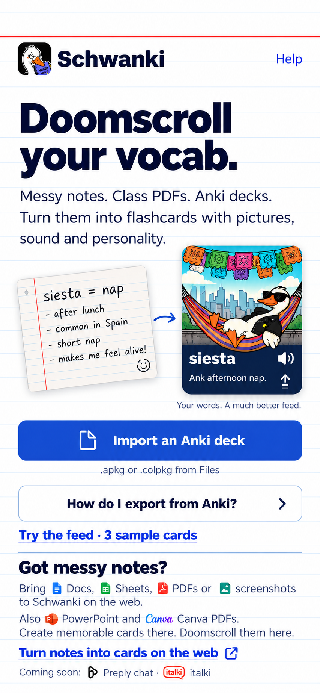
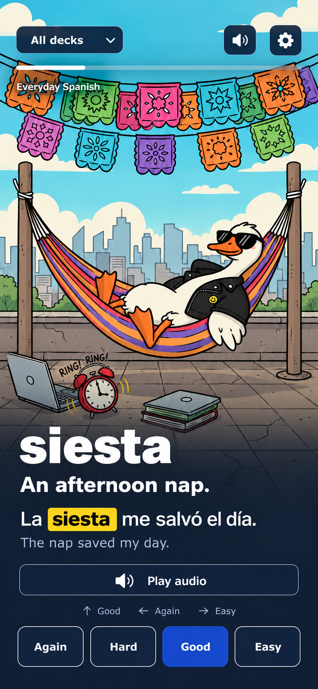

# Schwanki iOS — approved design direction

October 29, 2026. The user approved the direction with the final refinement:
source and platform icons must be tiny and inline with the previous version's
text, rather than a logo grid. These are the two current main-screen targets.
Native implementation is in `apps/ios`; see its README for setup and verification.

## Entry / bring your words

- Lead with “Doomscroll your vocab.” and the messy-notes-to-illustrated-feed
  preview. Anki is an immediate entry path, not the whole product promise.
- Keep the text-led notes paragraph. Docs, Sheets, PDFs, screenshots,
  PowerPoint and Canva PDF use tiny inline icons, approximately 12–14 pt,
  optically aligned with adjacent body text. No format grid or logo panels.
- Keep platform marks similarly small and inline: “Coming soon: Preply chat ·
  italki.” The status applies to both; these are informative future capabilities,
  not working native connect controls or partnership claims.
- Native primary action imports Anki files; notes and memory-aid creation
  remain on the web through the explicit notes-to-cards link.
- Keep the sample feed and export help secondary and easy to find.

## Revealed review feed

Keep the full-screen illustrated card, navy readability shade, large word,
meaning and highlighted example, accessible audio control and four ratings.
Good uses the blue primary-action color. This continues the approved feed from
visual-study-02; the final correction only affects entry-screen icon treatment.

## Implementation constraints

- Follow the accepted [storyboard and interaction notes](../README.md) and
  [companion scope](../../../ios-companion-plan.md).
- Use current white/navy/blue index-card tokens: white `#FFFFFF`, navy
  `#14213D`, primary blue `#2346B8`, faint blue rules `#E6ECF7`, red top rule
  `#C8372D`. Yellow `#F5D90A` belongs to vocabulary highlighting.
- Use actual Archivo fonts, the source Schwanki brand assets and proper source
  vector logos. The PNG mockups are generated visual targets, not asset masters
  or proof of exact color/typographic fidelity. Icon source provenance is in
  [visual-study-04](../visual-study-04/references/sources.txt).
- Do not shrink body copy or hit areas to reproduce a fixed image. Reflow and
  scrolling must accommodate small screens and Dynamic Type. Decorative inline
  icons should not duplicate adjacent source names in VoiceOver.
- The approved design does not add native note ingestion, AI creation, live
  Preply chat capture or italki support to v1.

Earlier visual-study folders are historical explorations. Use this directory
for the main-screen targets going forward.
