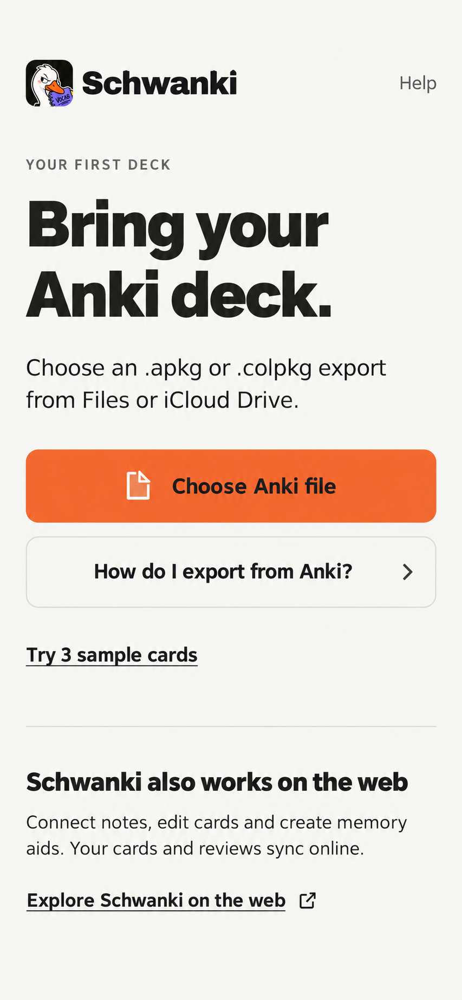
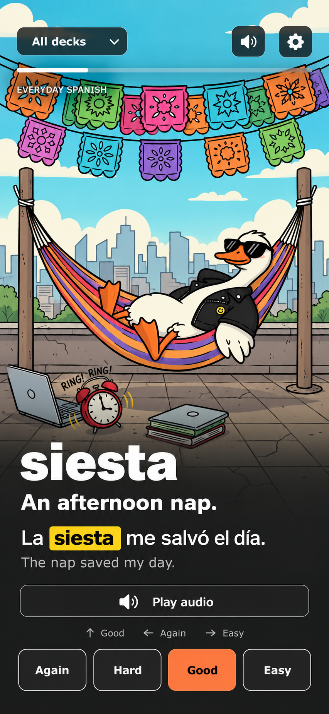

# Schwanki iOS — first visual pass

October 29, 2026 · Two primary screens · Static design mockups only.

Superseded: this pass used the older local cream/orange direction. Use the
[corrected index-card visual pass](../visual-study-02/README.md) instead.

The storyboard and wireframe structure was accepted before this pass. These
screens apply the existing Schwanki brand to frames 03 and 08; they are two
parts of one design direction, not alternative product concepts.

## Bring an Anki deck — frame 03

Paper surface, bold editorial typography, the existing brand lockup and a single
orange file action. Export help and the sample preview remain secondary. The
web companion explanation is visible without taking over onboarding.

## Review after reveal — frame 08

Existing Spanish demo artwork fills the feed. The sample word changes from
the wireframe's “sobremesa” to “siesta” to match the hammock scene. Charcoal
shading supports readable vocabulary and answer content. Yellow highlights
the target word in its example; orange emphasizes Good while retaining all
four functional ratings. Deck, sound and settings controls remain at the top.

## Grounding and limits

- Generated with the Product Design image workflow, using the actual wireframe
  boards, brand lockup, mascot and existing demo card art as image references.
- Intended logical viewport: 390 × 844 pt. Generated PNGs are visual targets,
  not editable Figma layers, a clickable prototype or app screenshots.
- Intended app tokens: paper `#F6F6F2`, charcoal `#232321`, beak orange
  `#F26A35`, acid yellow `#F5D90A`, Archivo typography. Image generation can
  approximate fonts, assets and color; exact source assets and tokens must be
  used in a subsequent editable design or implementation.
- No new app features, application code, dependencies or backend changes.
  Accessibility, small screens, Dynamic Type and interaction behavior remain
  governed by the wireframe notes and need verification in a later prototype.

[Back to storyboard and wireframes](../README.md)
