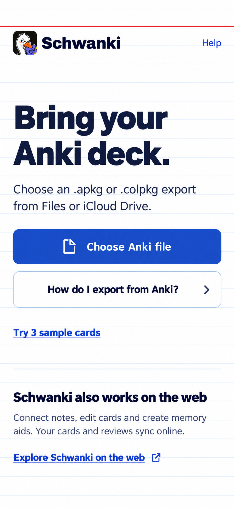

# Schwanki iOS — current index-card palette

October 29, 2026 · Corrected visual pass · Static mockups; no app code.

Entry-screen refinement: [messy notes to a memorable feed](../visual-study-03/README.md)
now leads with Schwanki's broader promise. The review screen below remains
the current target; the import image here records the earlier Anki-led copy.

This pass supersedes visual-study-01. The first pass used the older palette
from the local checkout. The user identified the mismatch; the current default
branch's design direction and app CSS were then read through GitHub.

## Current visual sources

- [DESIGN.md on main](https://github.com/La-Salida/schwanki/blob/main/DESIGN.md),
  Git blob `a93dc44f598cc4c6aa4cb09d6e5bdbd70018d34f`: October 28 index-card
  direction, white stock, navy ink, ruled-blue actions, faint blue rules and
  a red top rule. No all-caps heading eyebrows.
- [App CSS on main](https://github.com/La-Salida/schwanki/blob/main/apps/web/src/index.css),
  Git blob `e906614f19111399706e459b37ebb26bf6d84b80`: white `#FFFFFF`,
  navy `#14213D`, action blue `#2346B8`, muted text `#4A5570`, rules `#E6ECF7`,
  borders `#D5DEEE`, red rule `#C8372D`, vocabulary yellow `#F5D90A`.
- The remote brand README still contains the older cream/orange palette. The
  current DESIGN.md and app CSS take precedence for these mockups. The existing
  lockup was checked against the remote asset and is unchanged (Git blob
  `92bf16d7d3ffcd1b25a0509f18f9a9e8ca5d706f`).

## Import

White ruled surface, navy typography, a red top rule, blue primary action with
white label, blue links. The obsolete heading eyebrow is removed. The agreed
import flow, export help, sample preview and web-companion explanation remain.

## Revealed review

The feed retains its full-screen art and dark surface, with a navy treatment
and blue Good action. Vocabulary highlighting stays yellow. The illustration's
orange colors belong to the artwork, not the obsolete UI palette. Deck metadata
uses quieter title case.

## Scope

Both are image-generated visual targets for a 390 × 844 pt viewport. Exact
colors, fonts, source assets and accessibility still need verification in a
future editable design or prototype. Existing wireframe structure is preserved;
no application code, dependencies or backend configuration changed.

[Back to storyboard and wireframes](../README.md)
