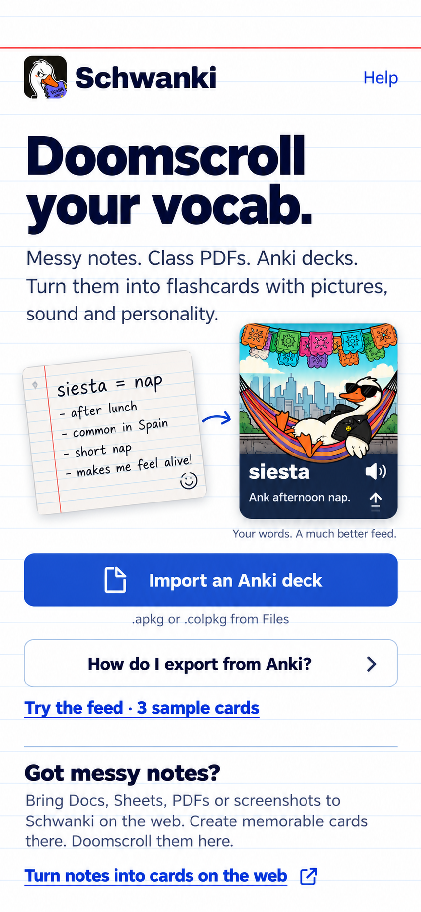

# Schwanki iOS — messy notes to a memorable feed

October 29, 2026 · Entry-screen refinement · Design only.

Refined further in [sources and platforms](../visual-study-04/README.md), which
adds recognizable format icons and clearly labeled upcoming integrations.

The approved white/navy/blue visual direction stays. This pass updates the
entry screen to communicate Schwanki's broader value before presenting the
immediate Anki import action. It supersedes the entry-screen copy and visual
hierarchy of visual-study-02. The [revealed feed design](../visual-study-02/08-review-revealed.png)
continues as the second main-screen target.

## What the first screen needs to communicate

- **Promise:** “Doomscroll your vocab.”
- **Inputs:** messy language notes, class PDFs and existing Anki decks, with
  concrete examples instead of an unsupported promise to import any website.
- **Result:** illustrated cards with audio and example sentences, reviewed in
  a vertical feed. A compact notes-to-feed illustration shows the difference
  rather than relying on comparison copy about Anki or Quizlet.
- **Immediate action:** import an Anki deck in the iOS app.
- **Try before setup:** “Try the feed · 3 sample cards.” Demo mode must carry
  that promise through to the existing sample-review flow.
- **Notes-first path:** “Got messy notes?” explains importing Docs, Sheets,
  PDFs or screenshots and creating cards on the web, with a direct
  “Turn notes into cards on the web” action. Return to iPhone for review using
  the same Schwanki account.

## Scope and behavior

The before/after illustration is sample product storytelling, not a native
note-upload control or AI generator. The native Anki import action still opens
Files; the notes action opens the web onboarding/source flow. Preserve the
same-account explanation at the browser handoff and refresh on returning to
iOS. Notes still pass through Inbox approval on the web before becoming cards.

Welcome should use the same broad promise so people without Anki understand
what Schwanki offers. The dedicated file preview and progress screens can use
plain task-specific import copy; the review feed stays focused on reviewing.

No extra native import formats, creation tools, navigation destinations,
subscription prompts or onboarding steps are introduced. This is a generated
static visual target, not implementation or proof of supported integrations.
At implementation time retain readable type and allow vertical scrolling on
smaller screens or with larger text rather than compressing this composition.

## Visual grounding

Generated as an edit using the actual corrected index-card import screen and
the illustrated Spanish feed as image references. Palette and structural
sources are recorded in [visual-study-02](../visual-study-02/README.md).
The intended viewport remains 390 × 844 pt. Exact tokens, fonts and assets
still require a later editable design/prototype pass. No app code changed.
