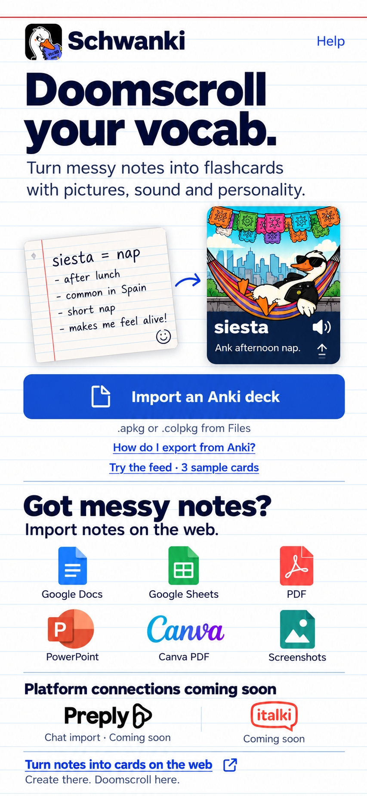

# Schwanki iOS — recognizable sources and platforms

October 29, 2026 · Entry-screen refinement · Design only.

Superseded by the [approved inline-icon treatment](../approved/README.md).
The user approved the direction but requested tiny marks inline with prose,
rather than the format grid and platform-logo row shown here.

This study keeps the accepted notes-to-feed
promise and index-card visual system, adding format icons and the requested
platform visibility. Pair it with the [revealed feed screen](../visual-study-02/08-review-revealed.png).

## Presentation and availability

| Icon or mark | Visible label/context | Meaning |
| --- | --- | --- |
| File icon on primary action | Import an Anki deck | Native iOS v1 import path |
| Blue Google Docs icon | Google Docs | Supported source on the web |
| Green Google Sheets icon | Google Sheets | Supported source on the web |
| Red PDF icon | PDF | Supported file import on the web |
| Orange PowerPoint icon | PowerPoint | Supported slide-text import on the web |
| Canva mark | Canva PDF | User exports a PDF from Canva and imports it on the web; not account sync |
| Image-file pictogram | Screenshots | Supported image/whiteboard-note import on the web |
| Preply mark | Chat import · Coming soon | Future chat capture; existing tutor-profile setup is not chat import |
| italki mark | Coming soon | Future platform connection shown at the user's request; not a shipped integration |

The source grid sits under “Import notes on the web.” The platform row has a
separate “Platform connections coming soon” heading and per-platform statuses.
Neither row is an active native connection picker. The shared web action
remains the path to source setup, using the same Schwanki account.

“Coming soon” presents the requested future capability without a launch date,
partnership claim, working connect button or inferred authorization to build
the integration. Reconfirm availability before release; keep these labels
specific rather than showing every logo as an available connection.

## Visual and implementation notes

- Keep the readable icon names; color or brand recognition alone is not enough.
- Give marks a consistent optical size and retain their own brand colors.
  White/navy/blue remains the app palette.
- Use a 3-column format grid with simple spacing, not six separate cards.
- Notes-first discovery, the playful preview and native Anki import remain
  prominent. This introduces no extra onboarding steps or native import modes.
- The mockup fits a portrait reference presentation. Actual content must scroll
  on smaller phones and with larger text; never shrink labels to fit a fixed
  screenshot. Links need at least 44 pt hit areas in the later prototype.
- This is an image-generated composition. Final editable design or
  implementation must use source vector marks rather than tracing generated
  logos. [Reference provenance](references/sources.txt) records downloaded
  sources, inspected icons and the five images actually attached to generation.

Availability was checked against `SourceForm.tsx` and `Sources.tsx` in the
workspace and [working scope on main](https://github.com/La-Salida/schwanki/blob/main/docs/working-scope.md),
Git blob `da5a5a6c3a431d130b6c4e239ee193862423fe24`. Some working-scope prose
lags shipped PowerPoint/screenshot support, which is visible in the source form.
The platform roadmap presentation follows the user's explicit request.

No application code, dependencies, backend settings or production data changed.
